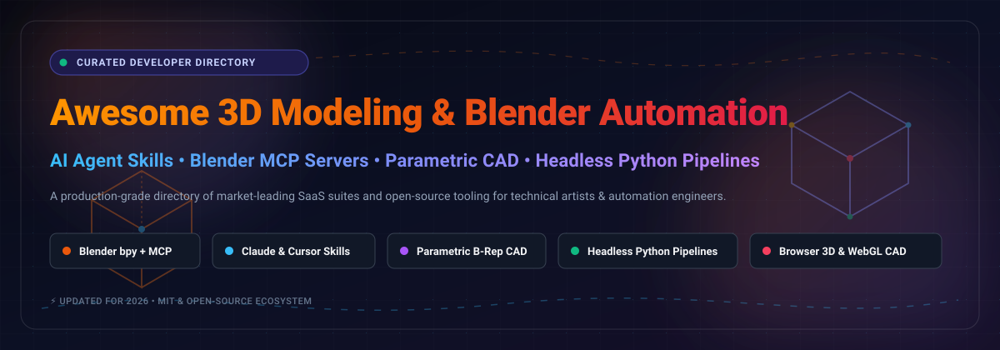

  
  
  
  
  
  

# 🚀 Awesome 3D Modeling & Blender Automation

### 💎 Curated Directory of 3D CAD SaaS Platforms, AI Agent Skills, Blender MCP Bridges & Headless Python Pipelines

---

## 📖 Table of Contents
- [🌐 Sector Overview & Market Dynamics](#-sector-overview--market-dynamics)
- [💼 SaaS & Hosted 3D Platforms](#-saas--hosted-3d-platforms)
- [🛠️ Open-Source GitHub Projects](#️-open-source-github-projects)
  - [🤖 Blender AI Agent Skills & MCP Automation Bridges](#-blender-ai-agent-skills--mcp-automation-bridges)
  - [📐 Core 3D Modeling Engines, Parametric CAD & Mesh Toolkits](#-core-3d-modeling-engines-parametric-cad--mesh-toolkits)
- [🤝 How to Contribute](#-how-to-contribute)
- [📈 Star History](#-star-history)
- [💖 Support & Sponsorship](#-support--sponsorship)
- [⚖️ Disclaimer](#️-disclaimer)

---

## 🌐 Sector Overview & Market Dynamics

The global **3D modeling, CAD, and digital content creation software market** is estimated at **$11.2B to $13.8B in 2025–2026**, expanding at an estimated **7.5% to 12.5% CAGR** through 2032 powered by cloud migration, spatial computing (AR/VR/VisionOS), generative AI geometry, and digital twin mandates.

The sector is **moderately fragmented yet top-heavy**: high-compliance enterprise CAD and architectural modeling remain concentrated among established legacy giants (Autodesk, Dassault Systèmes, PTC, Trimble), while creative 3D design, browser-based WebGL authoring, and AI agent automation remain highly fragmented, opening rapid growth for innovative SaaS startups (Spline, Vectary, Shapr3D) and dominant open-source ecosystems (Blender, FreeCAD, OpenCascade).

---

## 💼 SaaS & Hosted 3D Platforms

*Ranked by parent company size (annual revenue / enterprise valuation, descending).*

| Platform 🏷️ | Scale / Valuation 🏢 | Pricing (Starting Tier) 💳 | Free Tier & Free Trial Limits 🎁 | Description 📝 |
| :--- | :--- | :--- | :--- | :--- |
| **[Autodesk Tinkercad](https://tinkercad.com)** | Parent: Autodesk (~$62.8B Market Cap / ~$7.2B Rev) | **$0 / month** (Completely free education/hobbyist suite) | **Free forever without limits**: Full access to 3D design, Codeblocks, Circuits, and unlimited cloud project storage; no commercial usage restrictions. | Beginner-friendly browser CSG solid modeler and visual Codeblocks platform for rapid 3D printing and prototyping. |
| **[Autodesk Meshmixer](https://meshmixer.com)** | Parent: Autodesk (~$62.8B Market Cap / ~$7.2B Rev) | **$0 / month** (Freeware desktop release) | **Free forever without limits**: Uncapped triangle mesh smoothing, boolean repair, slicing, and tree-support generation tools; no paid upgrade tiers exist. | Industry-standard triangular mesh cleanup, remeshing, hollowing, and 3D-printing preparation desktop suite. |
| **[Onshape](https://onshape.com)** | Parent: PTC Inc. (~$21.2B Market Cap / ~$2.8B Rev) | **$1,250 / user / year** (Standard Tier) | **Free Forever (Public Workspace)**: Unlimited public documents and assemblies; **all documents are publicly searchable and copyable** by anyone; strictly non-commercial use only. | Cloud-native parametric mechanical CAD platform featuring real-time multi-user collaboration and FeatureScript automation. |
| **[SketchUp](https://sketchup.com)** | Parent: Trimble Inc. (~$18.6B Market Cap / ~$3.6B Rev) | **$129 / year** (~$10.75/mo, SketchUp Go) or **$399 / year** (Pro) | **Free Forever (Web Tier)**: Browser-only modeling, 10 GB Trimble Connect cloud storage, strictly personal/non-commercial use; monthly 3D Warehouse download caps apply. | Web and desktop architectural and spatial 3D modeler featuring intuitive push-pull direct modeling and Ruby API automation. |
| **[Shapr3D](https://shapr3d.com)** | ~$10M–$15M ARR (~$8.7M VC Funded) | **$25 / month** (billed annually at $299/year) or $37.99/mo | **Free Forever (Basic Plan)**: Maximum of **2 active project files** at one time; exports restricted to **low-resolution STL/3MF only**; 20 generative renders per month. | Multi-platform direct parametric CAD suite powered by the Siemens Parasolid engine on iPadOS, macOS, and Windows. |
| **[Spline](https://spline.design)** | ~$4M–$5.5M ARR ($25M VC Funded) | **$12 / month** (billed annually, Hobby Plan) or $15/month | **Free Forever (Starter)**: Unlimited personal public files and viewers; **web exports carry the Spline watermark**; no monthly generative AI credits. | Collaborative browser WebGL 3D design studio with real-time physics, interactivity, state machines, and React/HTML embeds. |
| **[Vectary](https://vectary.com)** | ~$3M–$6M ARR (~$14.4M VC Funded) | **$25 / month** (Starter/Pro Tier) | **Free Forever (Starter)**: Maximum **5 active projects**, single workspace seat (1 user), **3,000 monthly AI credits**, and Vectary-branded public embeds. | Browser-based parametric 3D modeling and product staging platform featuring no-code WebGL and Augmented Reality (AR) viewer integration. |
| **[Blender Studio](https://studio.blender.org/)** | Blender Foundation (~€3.1M / $3.3M Annual Budget) | **€11.50 / month** (~$12.50/mo, Studio Membership) | **Free Forever (Blender ID)**: Free accounts can view trailers and public previews; full open movie source assets, rigs, and production training courses require paid membership. | Official collaborative platform, training hub, and production asset library supporting the continuous development of Blender. |
| **[SelfCAD](https://selfcad.com)** | Bootstrapped (~$2.5M Estimated ARR) | **$14.99 / month** (Pro Tier) | **10-day full-featured Free Trial**, which then downgrades to a **Free Account**: Basic modeling/mesh drawing included; rendering, animation, and image-to-3D features locked. | All-in-one browser 3D modeling, sculpting, and slicing solution featuring interactive step-by-step CAD tutorials. |

---

## 🛠️ Open-Source GitHub Projects

*Ranked strictly by GitHub Stargazer Count (descending). Badges link directly to each repository's stargazers page.*

### 🤖 Blender AI Agent Skills & MCP Automation Bridges

| Project & Repository 📦 | GitHub_Stars ⭐ | Primary Tech & Ecosystem ⚙️ | Description 📝 |
| :--- | :--- | :--- | :--- |
| **[ahujasid/mcp-for-blender](https://github.com/ahujasid/mcp-for-blender)** |  | Model Context Protocol, Python, `bpy` | Foundational MCP integration connecting Blender 3D directly to Claude, Cursor, Codex, and VS Code for two-way socket control, execution, and Poly Haven/Sketchfab retrieval. |
| **[arjun988/blender-skills](https://github.com/arjun988/blender-skills)** |  | Claude Code, Cursor, Codex, Kiro | Comprehensive suite of 94 production Blender skill packs and 175+ reference files covering blockout, sculpting, retopology, UVs, shaders, and game exports. |
| **[EL4CTEO/blender-skills](https://github.com/el4cteo/blender-skills)** |  | Blender 5.2/5.3, Gemini CLI, OpenCode | Deterministic Blender agent skills providing 15-point automated QA, PBR material synthesis, bone rigging, animation setups, and KTX2 compression. |
| **[kevinbadi/blender-skills](https://github.com/kevinbadi/blender-skills)** |  | Claude Code, Blender bpy | Streamlined Claude Code automation skills focused on procedural studio lighting, product visualization, and dynamic framing presets. |
| **[majidmanzarpour/blender-game-skills](https://github.com/majidmanzarpour/blender-game-skills)** |  | Claude Code, GLB/FBX Game Pipeline | Automated game-asset skill suite transforming 2D concept art turnarounds into dimension-accurate, rigged, game-engine-ready GLB and FBX models. |
| **[RobLe3/cc-blender-skill](https://github.com/RobLe3/cc-blender-skill)** |  | Claude Code, Python bpy | Minimalist agent skill pack enabling Claude Code to generate scene geometry, set camera matrices, and execute headless renders. |
| **[ifBars/blender-agent-studio](https://github.com/ifBars/blender-agent-studio)** |  | Agent Routing, Evaluation, Geometry Nodes | End-to-end multi-agent orchestration framework coordinating procedural geometry generation, simulation, QA validation, and visual refinement. |
| **[seehiong/blender-mcp-bridge](https://github.com/seehiong/blender-mcp-bridge)** |  | FastMCP, Python, Blender 4.x | AI automation bridge exposing 93 discrete MCP tools across modeling, MEP, sculpting, material assignment, and session record/replay. |
| **[sandraschi/blender-mcp](https://github.com/sandraschi/blender-mcp)** |  | Headless Blender, CI/CD, MCP | Live-viewport and background headless MCP server designed for automated batch model processing, Geometry Node orchestration, and CI pipelines. |
| **[igamenovoer/blender-remote](https://github.com/igamenovoer/blender-remote)** |  | JSON-RPC, Python CLI, MCP | Dual background/GUI socket bridge allowing external AI scripts and terminals to control Blender viewport sessions via remote JSON-RPC. |
| **[BlenderKit/blenderkit_asset_tasks](https://github.com/BlenderKit/blenderkit_asset_tasks)** |  | Python CLI, Headless Blender | Production CLI scripts automating headless glTF conversion, multi-resolution texture baking, automated thumbnail rendering, and asset validation. |
| **[lukastomasek/blender-automation-tools](https://github.com/lukastomasek/blender-automation-tools)** |  | Blender Add-on, Python | Time-saving pipeline add-on automating transform applications, empty hierarchy pruning, automated collision generation, and batch export. |

---

### 📐 Core 3D Modeling Engines, Parametric CAD & Mesh Toolkits

| Project & Repository 📦 | GitHub_Stars ⭐ | Primary Tech & Ecosystem ⚙️ | Description 📝 |
| :--- | :--- | :--- | :--- |
| **[FreeCAD/FreeCAD](https://github.com/FreeCAD/FreeCAD)** |  | C++, Python, OpenCascade, Qt | Extensible open-source parametric 3D CAD/BIM modeler featuring modular workbenches, mechanical design, FEM analysis, and complete Python API scripting. |
| **[blender/blender](https://github.com/blender/blender)** |  | C, C++, Python, OpenGL/Vulkan | Premier open-source 3D creation suite powering modeling, sculpting, Geometry Nodes procedural automation, Cycles/EEVEE rendering, and `bpy` scripting. |
| **[CesiumGS/cesium](https://github.com/CesiumGS/cesium)** |  | JavaScript, WebGL, 3D Tiles | Open-source platform and 3D geospatial engine for rendering high-performance dynamic 3D globe visualizations and massive streaming meshes. |
| **[isl-org/Open3D](https://github.com/isl-org/Open3D)** |  | C++, Python, CUDA | Modern library for 3D data processing, point-cloud surface reconstruction, ICP registration, mesh decimation, and real-time visualization. |
| **[openscad/openscad](https://github.com/openscad/openscad)** |  | C++, OpenCSG, CGAL | Programmers' solid 3D CAD compiler rendering deterministic constructive solid geometry (CSG) models directly from declarative script files. |
| **[prusa3d/PrusaSlicer](https://github.com/prusa3d/PrusaSlicer)** |  | C++, wxWidgets, Boost | Advanced open-source tool converting 3D models into G-code printing instructions for FDM/SLA 3D printers with automated mesh repair. |
| **[CadQuery/cadquery](https://github.com/CadQuery/cadquery)** |  | Python, OpenCascade, OCP | Python parametric B-Rep CAD scripting library based on OpenCascade designed to build complex mechanical engineering models programmatically. |
| **[cnr-isti-vclab/meshlab](https://github.com/cnr-isti-vclab/meshlab)** |  | C++, Qt, VCGlib | Comprehensive open-source software for processing, filtering, inspecting, cleaning, remeshing, and converting massive unstructured 3D triangular meshes. |
| **[bambulab/BambuStudio](https://github.com/bambulab/BambuStudio)** |  | C++, Python, WebGL | Cutting-edge 3D slicer supporting multi-material printing, cloud sync, direct assembly modeling, and automated mesh orientation. |
| **[gumyr/build123d](https://github.com/gumyr/build123d)** |  | Python, OpenCascade (OCP) | Modern Python boundary-representation (B-Rep) CAD framework utilizing context managers and clean chaining syntax for mechanical automation. |
| **[jscad/OpenJSCAD.org](https://github.com/jscad/OpenJSCAD.org)** |  | JavaScript, WebGL | Open-source modular toolkit for programmatic 3D CAD modeling directly in the browser and Node.js using standard JavaScript code. |
| **[dune3d/dune3d](https://github.com/dune3d/dune3d)** |  | C++, OpenCascade, Horizon | Standalone open-source 3D CAD application featuring constraint-based sketch solving and geometric feature modeling on top of OpenCascade. |
| **[cnr-isti-vclab/PyMeshLab](https://github.com/cnr-isti-vclab/PyMeshLab)** |  | Python, C++ (MeshLab core) | Headless Python bindings for the MeshLab mesh-processing library for batch polygon cleaning, simplification, and normal calculation. |

---

## 🤝 How to Contribute

Contributions are warmly welcomed! Help keep this ecosystem the most comprehensive reference on the web:

1. 🍴 **Fork** this repository.
2. 🌿 **Create a new branch** (`git checkout -b feature/add-new-tool`).
3. 📝 **Add your entry** under the relevant section maintaining the tabular format (include specific pricing/limits for SaaS or Stars_Badge and accurate tech stack for open-source).
4. ✅ **Ensure accuracy** with factual descriptions, active links, and correct licensing.
5. 🚀 **Submit a Pull Request** with a brief summary of the project added.

---

## 📈 Star History

---

## 💖 Support & Sponsorship

If you find this curated directory helpful for your 3D modeling pipelines, AI agent workflows, or CAD development, please consider showing your support:

- ⭐ **Star this repository** to improve discoverability.
- 🍴 **Fork and share** with technical artists, 3D developers, and AI researchers.
- ☕ **Buy a coffee or sponsor ongoing maintenance**: Support via the [GitHub Sponsor Dashboard](https://github.com/sponsors/ishandutta2007).

Your sponsorship directly funds the tracking and benchmarking of new open-source agent skill packs and 3D automation tools! ✨

---

## ⚖️ Disclaimer

*This list is community-curated for informational, educational, and developer reference purposes. Mention of commercial products or open-source repositories does not constitute formal endorsement. All trademarks, logos, and brand names are the property of their respective owners.*
